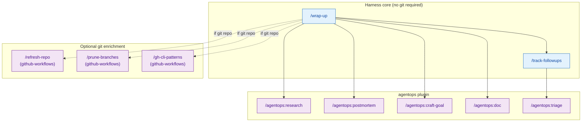

# ai-cli-harness-better-practices — Architecture

Session continuity for AI CLI harnesses. No skill here requires a git
repository; git and GitHub are optional enrichment, guarded per skill.

## Skill Map



## The git guard

Every enrichment section is gated by one check:

```bash
git rev-parse --is-inside-work-tree >/dev/null 2>&1
```

Success runs the section. Failure skips it and the skill states the omission in
its output. Nothing errors; nothing is silently dropped.

**The guard proves repo-ness, not GitHub reachability.** They are different
conditions and a repository can satisfy the first while failing the second: no
`origin` remote, a non-GitHub remote, `gh` not installed, or `gh` unauthenticated.
So any `gh` call inside a gated block carries its own failure handling — treat a
non-zero `gh` exit as "unknown", never as "none found", and say which check did
not run. Reporting an unchecked list as clean is the failure this whole design
exists to prevent.

## Resolving the default branch

Commands that name a default branch use the repository's actual default, never a
hardcoded `main`. Resolve it with this exact sequence:

```bash
default_branch=$(git symbolic-ref --short refs/remotes/origin/HEAD 2>/dev/null)
default_branch=${default_branch#origin/}
[ -n "$default_branch" ] || default_branch=$(
  gh repo view --json defaultBranchRef --jq '.defaultBranchRef.name' 2>/dev/null)
```

**Inline this at every use site — never reference it across blocks.** A harness
runs each command block in its own shell; only the working directory carries
over, not variables. Resolving in one block and reading `$default_branch` in
another yields an empty value *every time*, which silently pins every check to
its unknown branch. Each skill therefore repeats these three lines immediately
above the command that needs them. The duplication is deliberate: a correct
copy beats a shared definition that never reaches its use.

**Never interpolate this unguarded.** `refs/remotes/origin/HEAD` is unset in any
repository that was not cloned — `git init` plus a fetch, and `actions/checkout`
in CI, both leave it missing. Substituting the empty result produces
`git log ""..HEAD`, which **exits 0 and prints nothing**: indistinguishable from
a genuinely clean branch. That is the silent-false-clean this whole design exists
to prevent, so branch on it explicitly:

```bash
default_branch=$(git symbolic-ref --short refs/remotes/origin/HEAD 2>/dev/null)
default_branch=${default_branch#origin/}
[ -n "$default_branch" ] || default_branch=$(
  gh repo view --json defaultBranchRef --jq '.defaultBranchRef.name' 2>/dev/null)

if [ -z "$default_branch" ]; then
  echo "default branch unknown — report as unknown, never as 'no changes'"
else
  git log "origin/$default_branch..HEAD"
fi
```

That block is complete on purpose: resolution and use in one shell. Copy it
whole, never just the `if`.

The same rule governs any check keyed on the default branch's *name* (for
example "is this a git-flow repo?"): an unresolved default must report unknown,
not silently take the "no" path and skip a check that would otherwise have run.

## agentops composition

`/goal`, `/session-status`, `/replan` and `/wrap-up-docs` are shims
that point to agentops skills. `/wrap-up` composes those skills and keeps only
what is specific here: the completion verdict, the git-flow promotion gate, the
Path B resume blocks, and `purge-pr` mode. `/track-followups` keeps the tracker
routing and creation mechanics.
